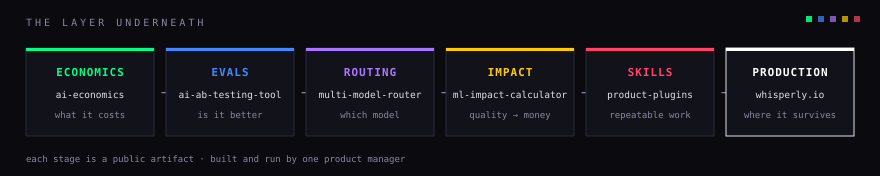

# Hey, I'm Evgeny 👋

Every AI product has two lives. The first is the demo: a hand-picked request, a strong model, an impressed room, and nobody asking what it cost. The second starts when real traffic arrives, and it runs on different fuel: cost per request, quality nobody is watching anymore, latency at the 99th percentile, a bill that grows faster than usage. Most teams prepare carefully for the first life and improvise the second.

I'm a product manager who builds the layer underneath AI products: the economics, evals, and decision infrastructure that decide whether they survive production. The full argument: [After the Demo](https://github.com/alexe-ev/ai-economics/blob/main/after-the-demo.md).

[whisperly.io](https://whisperly.io) · [LinkedIn](https://www.linkedin.com/in/evgeny-alexeev) · [AI Economics series](https://github.com/alexe-ev/ai-economics#the-ai-economics-series)

## In production

[Whisperly](https://whisperly.io) is a paid macOS dictation app I build and run solo: it turns messy speech into clean, ready-to-send text. It is also where this layer gets tested on real users. The eval harness gates every release, and unit economics is a product constraint, so every model swap is a margin decision. Its open-source predecessor is [Murmur](https://github.com/alexe-ev/Murmur).

## The system

Every repo here started as a decision I needed a number for. Six stages, one direction:



[ai-economics](https://github.com/alexe-ev/ai-economics) → [ai-ab-testing-tool](https://github.com/alexe-ev/ai-ab-testing-tool) → [multi-model-router](https://github.com/alexe-ev/multi-model-router) → [ml-impact-calculator](https://github.com/alexe-ev/ml-impact-calculator) → [product-plugins](https://github.com/alexe-ev/product-plugins) → [whisperly.io](https://whisperly.io)

<details>
<summary>Text version</summary>

```
economics        → evals         → routing      → impact           → skills           → production
what it costs    → is it better  → which model  → quality to money → repeatable work  → where it survives
```

</details>

## The research

[AI Economics](https://github.com/alexe-ev/ai-economics): 26 posts written March to May 2026, from token pricing through model selection and agent cost patterns to unit economics. The interactive calculator implements the math. [Read the series](https://github.com/alexe-ev/ai-economics#the-ai-economics-series) or [open the calculator](https://alexe-ev.github.io/ai-economics/).

## Now

Shipping Whisperly for macOS, prototyping its iOS app, writing build-in-public essays on [LinkedIn](https://www.linkedin.com/in/evgeny-alexeev). *Updated August 2026.*

## Contact

💬 [Telegram](https://t.me/alexe_ev) · 💼 [LinkedIn](https://www.linkedin.com/in/evgeny-alexeev)
